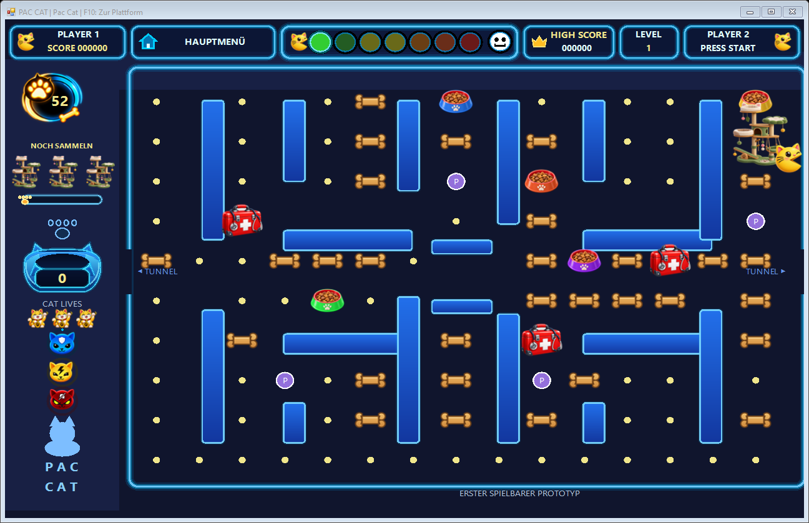

# Pac Cat

Pac Cat ist ein kleines Labyrinthspiel für Windows: Steuere eine Katze durch das Labyrinth, sammle Leckerlis und weiche Gefahren aus. Futternäpfe, Medkits, Powerobjekte und Katzenbäume ergänzen das Spiel.

Diese erste Testveröffentlichung enthält fünf auswählbare Spielwelten mit insgesamt 60 vorbereiteten Levelplätzen. Die Level verwenden vorhandene Labyrinthvorlagen; 60 vollständig unterschiedliche Labyrinthe werden damit nicht versprochen. Die Spielausgabe enthält keinen Leveleditor.

## Herunterladen und starten

Nach Veröffentlichung findest du unter **Releases** die Datei **Pac-Cat.exe**. Lade diese Datei herunter und starte sie per Doppelklick. Ein GitHub-Konto ist zum Herunterladen einer öffentlichen Veröffentlichung nicht erforderlich. Ein ZIP-Paket mit Anleitung wird zusätzlich angeboten. Nicht den automatisch erzeugten „Source code“-Download wählen.

Die EXE enthält die benötigten Spielgrafiken. Ein zusätzlicher Asset-Ordner oder eine Installation des Spiels ist nicht nötig. Voraussetzung ist Windows mit .NET Framework 4.5 oder neuer. Auf dem Windows-PC der Entwicklung wurde die getrennte Ausgabe geprüft; andere Windows-Versionen sind noch nicht abschließend getestet. macOS, Linux und Browser werden durch diese Ausgabe nicht unterstützt.

## Kurz erklärt

1. Öffne **Spielwelten**, wähle eine Welt und anschließend ein Level.
2. Bewege Pac Cat mit den **Pfeiltasten** oder **WASD**.
3. Sammle die verbleibenden Leckerlis, achte auf die Lebensanzeige und meide Hundeknochen und Geister.
4. **Esc** öffnet das Spielmenü. **F10** bringt dich zurück zur Spielauswahl. **R** startet das aktuelle Level neu.

Fortschritt und Highscores werden lokal im Windows-Benutzerordner gespeichert. Es werden keine persönlichen Spielstände mitgeliefert. Die ausführlichere Anleitung steht in [ANLEITUNG.md](ANLEITUNG.md).

## Stand und Hinweise

Diese Ausgabe ist ein früher spielbarer Stand. Teile der Oberfläche enthalten weiterhin Prototyptexte oder vorbereitete Funktionen. Eine Anzeige „PLAYER 2“ ist keine Zusage eines fertigen Mehrspielermodus. Die EXE ist nicht digital signiert; Windows kann beim Download oder Start eine Warnung anzeigen. Sicherheitsfunktionen müssen für das Spiel nicht pauschal deaktiviert werden.

Quellen verwendeter Fremdinhalte stehen in [QUELLEN.md](QUELLEN.md). Diese Veröffentlichung beinhaltet keine Open-Source-Lizenz für den Spielcode und erteilt keine pauschalen Nutzungsrechte an einzelnen Grafiken oder Musikdateien.
